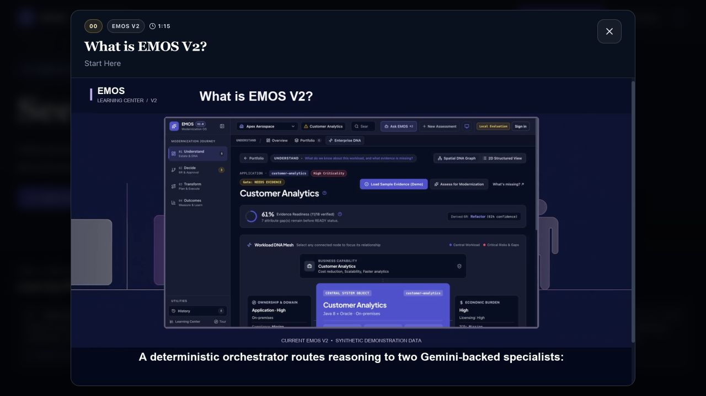

# EMOS V2 learning library verification

18 unique masters cover all 41 Learning Center placements (20 catalog, 16 guides, four stage links, one hero). Three homepage entry points reuse the same masters.

Exact Killian was unavailable in the 115-voice catalog. The user explicitly selected Cillian and approved a 1,600-credit cap. Observed spend: 1,526.2 credits. Six failed audio jobs were successfully retried; no unresolved generations. Higgsfield generation took approximately eight minutes; finishing and QA are additional.

Higgsfield Seedance 2.5 supplied motion and Seed Audio supplied narration. Local finishing combines those outputs with actual current production screenshots and synchronized phrase captions rendered into every MP4. No generated UI. Narration validation uses speech alignment against the approved scripts; visual QA samples two frames from every final video. All 18 files pass full audio/video decode, format, duration and caption checks.

Lint and build pass; Vitest: 294/294; GitHub release gate also passes eight Firestore emulator tests. Local native playback, mute, seek, Escape/focus return, homepage integration and 390px layout pass. No live Gemini suite was rerun. Production checks pass on the final revision.

The accessible MoveBooks AcademyPlayer/WatchGuide implementations informed native controls, poster/loading/retry and keyboard behavior. EMOS information architecture is preserved.

## Complete placement map

| Existing Entry | V2 Replacement | Duration | Voice | Subtitles | Asset | Status |
|---|---|---|---|---|---|---|
| catalog · 00 · EMOS Beta Introduction | What is EMOS V2? | 74.6s | Cillian | Burned in | [MP4](https://emos-modernization-1027874783780.asia-southeast1.run.app/media/learning/emos-v2-orientation.mp4) | PASS |
| catalog · F01 · Sign in and enter the private workspace | Navigate EMOS and your workspace | 44.6s | Cillian | Burned in | [MP4](https://emos-modernization-1027874783780.asia-southeast1.run.app/media/learning/emos-v2-workspace.mp4) | PASS |
| catalog · F02 · Take the guided product tour | Navigate EMOS and your workspace | 44.6s | Cillian | Burned in | [MP4](https://emos-modernization-1027874783780.asia-southeast1.run.app/media/learning/emos-v2-workspace.mp4) | PASS |
| catalog · F03 · Submit a workload for a 6R assessment | 6R decisions and the Enterprise Architect | 59.6s | Cillian | Burned in | [MP4](https://emos-modernization-1027874783780.asia-southeast1.run.app/media/learning/emos-v2-decision.mp4) | PASS |
| catalog · F04 · Explore options and generate an executive decision | 6R decisions and the Enterprise Architect | 59.6s | Cillian | Burned in | [MP4](https://emos-modernization-1027874783780.asia-southeast1.run.app/media/learning/emos-v2-decision.mp4) | PASS |
| catalog · F05 · Refine an assessment with new evidence | Ask EMOS and governed AI | 59.6s | Cillian | Burned in | [MP4](https://emos-modernization-1027874783780.asia-southeast1.run.app/media/learning/emos-v2-ask.mp4) | PASS |
| catalog · F06 · Verify owner-bound persistence and privacy | Private workspace and assessment history | 44.6s | Cillian | Burned in | [MP4](https://emos-modernization-1027874783780.asia-southeast1.run.app/media/learning/emos-v2-privacy-history.mp4) | PASS |
| catalog · F07 · Search, filter, and manage assessment history | Private workspace and assessment history | 44.6s | Cillian | Burned in | [MP4](https://emos-modernization-1027874783780.asia-southeast1.run.app/media/learning/emos-v2-privacy-history.mp4) | PASS |
| catalog · F08 · Preserve cloud-platform neutrality | 6R decisions and the Enterprise Architect | 59.6s | Cillian | Burned in | [MP4](https://emos-modernization-1027874783780.asia-southeast1.run.app/media/learning/emos-v2-decision.mp4) | PASS |
| catalog · F09 · Validate assessment-score consistency | Evidence gates and explicit human approval | 44.6s | Cillian | Burned in | [MP4](https://emos-modernization-1027874783780.asia-southeast1.run.app/media/learning/emos-v2-governance.mp4) | PASS |
| catalog · F10 · Explore the sample enterprise portfolio | Portfolio Discovery and its specialist | 44.6s | Cillian | Burned in | [MP4](https://emos-modernization-1027874783780.asia-southeast1.run.app/media/learning/emos-v2-discovery.mp4) | PASS |
| catalog · F11 · Inspect Enterprise DNA and evidence gaps | Enterprise DNA and evidence readiness | 44.6s | Cillian | Burned in | [MP4](https://emos-modernization-1027874783780.asia-southeast1.run.app/media/learning/emos-v2-dna.mp4) | PASS |
| catalog · F12 · Go from Enterprise DNA to assessment in one click | Enterprise DNA and evidence readiness | 44.6s | Cillian | Burned in | [MP4](https://emos-modernization-1027874783780.asia-southeast1.run.app/media/learning/emos-v2-dna.mp4) | PASS |
| catalog · F13 · Import a CSV or JSON portfolio | Import and assess a portfolio | 44.6s | Cillian | Burned in | [MP4](https://emos-modernization-1027874783780.asia-southeast1.run.app/media/learning/emos-v2-import.mp4) | PASS |
| catalog · F14 · Download a sample enterprise dataset | Import and assess a portfolio | 44.6s | Cillian | Burned in | [MP4](https://emos-modernization-1027874783780.asia-southeast1.run.app/media/learning/emos-v2-import.mp4) | PASS |
| catalog · F15 · Assess and manage imported workloads | Import and assess a portfolio | 44.6s | Cillian | Burned in | [MP4](https://emos-modernization-1027874783780.asia-southeast1.run.app/media/learning/emos-v2-import.mp4) | PASS |
| catalog · F16 · Switch appearance and use responsive layouts | Navigate EMOS and your workspace | 44.6s | Cillian | Burned in | [MP4](https://emos-modernization-1027874783780.asia-southeast1.run.app/media/learning/emos-v2-workspace.mp4) | PASS |
| catalog · F17 · Fence adversarial prompts and redact secrets | Trust, guardrails, and evaluation | 44.6s | Cillian | Burned in | [MP4](https://emos-modernization-1027874783780.asia-southeast1.run.app/media/learning/emos-v2-security.mp4) | PASS |
| catalog · F18 · Enforce canonical 6R and evidence readiness | Evidence gates and explicit human approval | 44.6s | Cillian | Burned in | [MP4](https://emos-modernization-1027874783780.asia-southeast1.run.app/media/learning/emos-v2-governance.mp4) | PASS |
| catalog · F19 · Plan and mobilize the modernization program | Wave planning and governed execution | 44.6s | Cillian | Burned in | [MP4](https://emos-modernization-1027874783780.asia-southeast1.run.app/media/learning/emos-v2-execution.mp4) | PASS |
| topic-guide · what-is-emos · What is EMOS? | What is EMOS V2? | 74.6s | Cillian | Burned in | [MP4](https://emos-modernization-1027874783780.asia-southeast1.run.app/media/learning/emos-v2-orientation.mp4) | PASS |
| topic-guide · product-vision · Product Vision | What is EMOS V2? | 74.6s | Cillian | Burned in | [MP4](https://emos-modernization-1027874783780.asia-southeast1.run.app/media/learning/emos-v2-orientation.mp4) | PASS |
| topic-guide · getting-started · Getting Started | Navigate EMOS and your workspace | 44.6s | Cillian | Burned in | [MP4](https://emos-modernization-1027874783780.asia-southeast1.run.app/media/learning/emos-v2-workspace.mp4) | PASS |
| topic-guide · portfolio-upload · Portfolio Upload | Import and assess a portfolio | 44.6s | Cillian | Burned in | [MP4](https://emos-modernization-1027874783780.asia-southeast1.run.app/media/learning/emos-v2-import.mp4) | PASS |
| topic-guide · enterprise-dna · Enterprise DNA | Enterprise DNA and evidence readiness | 44.6s | Cillian | Burned in | [MP4](https://emos-modernization-1027874783780.asia-southeast1.run.app/media/learning/emos-v2-dna.mp4) | PASS |
| topic-guide · modernization-agent · Modernization Agent | Ask EMOS and governed AI | 59.6s | Cillian | Burned in | [MP4](https://emos-modernization-1027874783780.asia-southeast1.run.app/media/learning/emos-v2-ask.mp4) | PASS |
| topic-guide · 6r-overview · 6R Overview | 6R decisions and the Enterprise Architect | 59.6s | Cillian | Burned in | [MP4](https://emos-modernization-1027874783780.asia-southeast1.run.app/media/learning/emos-v2-decision.mp4) | PASS |
| topic-guide · retain · Retain (Keep it as-is) | Retain — Govern & Monitor | 29.6s | Cillian | Burned in | [MP4](https://emos-modernization-1027874783780.asia-southeast1.run.app/media/learning/emos-v2-retain.mp4) | PASS |
| topic-guide · retire · Retire (Safely shut it down) | Retire — Safely Decommission | 29.6s | Cillian | Burned in | [MP4](https://emos-modernization-1027874783780.asia-southeast1.run.app/media/learning/emos-v2-retire.mp4) | PASS |
| topic-guide · rehost · Rehost (Move it largely unchanged) | Rehost — Migrate Infrastructure | 29.6s | Cillian | Burned in | [MP4](https://emos-modernization-1027874783780.asia-southeast1.run.app/media/learning/emos-v2-rehost.mp4) | PASS |
| topic-guide · replatform · Replatform (Move it to a better platform) | Replatform — Transition Platform | 28.8s | Cillian | Burned in | [MP4](https://emos-modernization-1027874783780.asia-southeast1.run.app/media/learning/emos-v2-replatform.mp4) | PASS |
| topic-guide · refactor · Refactor (Redesign parts of it) | Refactor — Transform Architecture | 29.6s | Cillian | Burned in | [MP4](https://emos-modernization-1027874783780.asia-southeast1.run.app/media/learning/emos-v2-refactor.mp4) | PASS |
| topic-guide · repurchase · Repurchase (Replace it with another product) | Repurchase — Replace & Adopt | 29.6s | Cillian | Burned in | [MP4](https://emos-modernization-1027874783780.asia-southeast1.run.app/media/learning/emos-v2-repurchase.mp4) | PASS |
| topic-guide · governance · Governance | Evidence gates and explicit human approval | 44.6s | Cillian | Burned in | [MP4](https://emos-modernization-1027874783780.asia-southeast1.run.app/media/learning/emos-v2-governance.mp4) | PASS |
| topic-guide · execution · Execution | Wave planning and governed execution | 44.6s | Cillian | Burned in | [MP4](https://emos-modernization-1027874783780.asia-southeast1.run.app/media/learning/emos-v2-execution.mp4) | PASS |
| topic-guide · outcomes-learning · Outcomes & Learning | Measure and Learn: V2 boundaries | 52.9s | Cillian | Burned in | [MP4](https://emos-modernization-1027874783780.asia-southeast1.run.app/media/learning/emos-v2-outcomes.mp4) | PASS |
| stage-link · understand · Understand | Portfolio Discovery and its specialist | 44.6s | Cillian | Burned in | [MP4](https://emos-modernization-1027874783780.asia-southeast1.run.app/media/learning/emos-v2-discovery.mp4) | PASS |
| stage-link · decide · Decide | 6R decisions and the Enterprise Architect | 59.6s | Cillian | Burned in | [MP4](https://emos-modernization-1027874783780.asia-southeast1.run.app/media/learning/emos-v2-decision.mp4) | PASS |
| stage-link · transform · Transform | Wave planning and governed execution | 44.6s | Cillian | Burned in | [MP4](https://emos-modernization-1027874783780.asia-southeast1.run.app/media/learning/emos-v2-execution.mp4) | PASS |
| stage-link · outcomes · Outcomes | Measure and Learn: V2 boundaries | 52.9s | Cillian | Burned in | [MP4](https://emos-modernization-1027874783780.asia-southeast1.run.app/media/learning/emos-v2-outcomes.mp4) | PASS |
| hero · guided-journey · Start Guided Journey | What is EMOS V2? | 74.6s | Cillian | Burned in | [MP4](https://emos-modernization-1027874783780.asia-southeast1.run.app/media/learning/emos-v2-orientation.mp4) | PASS |

## Release cache correction

Production verification exposed a pre-existing HTML validator collision: Buildpacks normalize file modification times, and equal-sized HTML shells reused the same weak ETag across releases. Returning browsers could retain a shell referencing a removed JavaScript bundle. The scoped serving fix sends the HTML shell with `Cache-Control: no-store` and disables its ETag/Last-Modified validators. Media static serving and byte-range behavior remain unchanged. Conditional requests with the previous validator now return HTTP 200 and the current shell. Lint, build, all 294 software tests and the GitHub release gate pass after this fix.

## Final production result

- Repository: `JEMathew/emos-enterprise-modernization`; product: EMOS V2.
- Content commit: `453504249591768424928e095eaae119fb306168`.
- Final deployed commit (includes HTML cache correction): `ec94d9ecbb9e027156aefe7518049d7dc24f01b0`; pushed to `main`.
- Cloud Run: `emos-modernization-00004-lch`, `asia-southeast1`, 100% traffic.
- [Production Learning Center](https://emos-modernization-1027874783780.asia-southeast1.run.app/learn).
- All 41 Learning Center placements and three homepage entry points opened and played in the browser. All 18 unique masters decoded and advanced; mute, seek, Escape/focus return and local 390px layout verified.
- All 54 production MP4/poster/transcript files match local SHA-256 hashes; all 18 MP4s return HTTP 206 for byte ranges.
- Software tests: 294/294; CI additionally passed 8/8 Firestore emulator tests. [Final release gate](https://github.com/JEMathew/emos-enterprise-modernization/actions/runs/44833660288).
- Core smoke: public sandbox → workspace → DNA → blocked governance → Transform plan → representative Outcomes. Final revision workspace also loads with workload context and evidence gate intact. No critical browser console errors observed. No live Gemini calls were rerun.
- Runtime configuration fingerprint is unchanged; no Auth/Firebase/Gemini/Secret Manager settings changed.
- Missing subtitles: 0. Stale active V1 videos: 0. Broken links: 0. Unresolved failed generations: 0 (six failed audio attempts recovered).
- MoveBooks-style native playback: PASS. Learning Center V2: PASS. All video links: PASS. Core regression: PASS. Ready for Buildathon submission under this video-refresh scope: YES.

