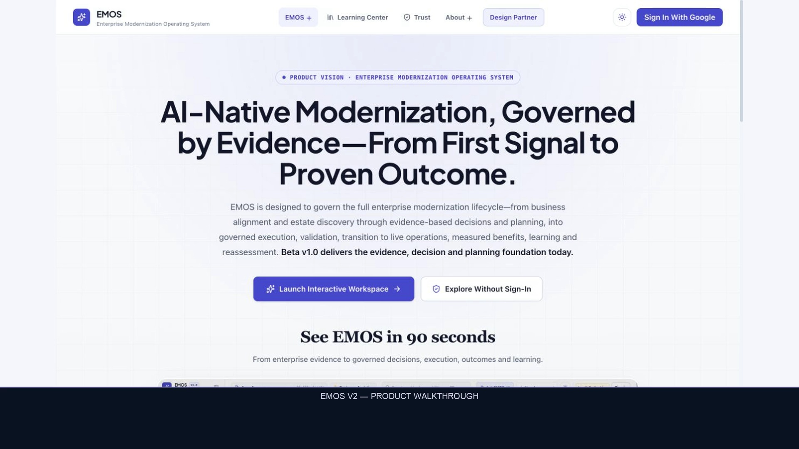

# EMOS V2 — Product Walkthrough

**2:57 · 1920 × 1080 · Light-mode product UI · Cillian narration · Burned-in subtitles**

[Watch or download the final MP4](https://github.com/JEMathew/emos-enterprise-modernization/raw/refs/heads/main/docs/product-walkthrough/emos-v2-product-walkthrough.mp4) · [Transcript](emos-v2-product-walkthrough.txt) · [SRT captions](emos-v2-product-walkthrough.srt) · [Live product](https://emos-modernization-1027874783780.asia-southeast1.run.app/)

## What it shows

The real landing page leads into Apex Aerospace's portfolio, 10,420+ asset reference context, Enterprise DNA, evidence readiness and the Portfolio Discovery Gemini specialist. The journey continues through 6R decisioning, the Enterprise Architect specialist, deterministic governance, Human Approval, Wave Planning and Plan/Execute.

Aerospace's Enterprise Data Warehouse follows **Replatform → Transition Platform**. Banking's ATM/HSM Switch follows **Retain → Govern & Monitor**. The video then shows all six workflows, Measure, Learn and verified V2.0 evidence.

[Follow the timestamped product route](../DEMO_FLOW.md) · [Architecture](../ARCHITECTURE.md) · [Product contract](../../EMOS_V2_PRODUCT_CONTRACT.md)

## Current-product boundaries

- Reference estates are not real customers. The 10,420+ asset context is not a live-connected production inventory.
- Evidence completeness and Human Approval are separate. The genuine evidence-loading control does not establish external verification.
- Execute provides governed workflow orchestration, not autonomous external infrastructure mutation.
- Measure uses reference values; Learn includes session-scoped notes. Live production telemetry and persistent organizational learning remain future scope.
- The current landing page's pre-existing Beta v1.0 wording and all genuine product UI labels remain unmodified.

## Asset verification

This is the approved final walkthrough, copied without re-encoding or regenerating it. Duration is 177 seconds. Conservative real-product-UI coverage is 95.17%; the remaining time is a six-second verification card and a 2.55-second comparison containing actual product excerpts. There is no generated or conceptual product footage.

SHA-256: `8f6965313d2a761a9fec348d70c3c635f50955f578360fc80ba5cb79ba0c92ee`.

The [evidence index](../EVIDENCE_INDEX.md) distinguishes software tests, local evals, successful model calls and scenario correctness. The recorded evidence does not claim universal answer correctness or production-scale performance.
